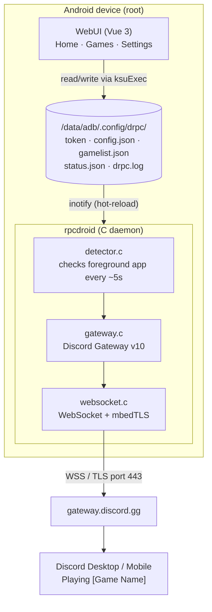

# RPCDroid

Root module for Magisk, KernelSU, and APatch that sends Android game activity to Discord Rich Presence.


-informational)

[Bahasa Indonesia](README.md) | [English](README.en.md)

<!--
  Add screenshots here, for example:
  <p align="center">
    
    
    
  </p>
-->

## Summary

When a game is opened on the phone, the Discord account status displays the game name, its icon, and playtime (for example *Playing Mobile Legends*). The status is removed automatically when the game is closed.

This is handled by a native daemon (`rpcdroid`) running as a module service, connected directly to the Discord Gateway over a TLS WebSocket. Configuration is done through a WebUI opened from the root manager app.

## Approach

This module does not use an Android app service or accessibility permissions. Game detection is performed by the daemon reading the foreground app via `dumpsys`, and the connection to Discord is managed by the same daemon.

Daemon resource usage is around 1–2 MB of RAM with near-zero CPU load while idle.

## Features

- Periodic detection of the running game (default: every 5 seconds).
- Database of 470+ Android game packages. Games installed on the device are mapped automatically during installation.
- Icon support for games not registered in Discord (see [Icon mechanism](#icon-mechanism)).
- WebUI to configure the token, enable or disable games, rename the display name, and view logs.
- Automatic configuration reload without restarting the daemon.
- Binaries for `arm64-v8a`, `armeabi-v7a`, and `x86_64`.

> [!WARNING]
> This module authenticates to Discord using an **account user token**, not a bot token.
>
> - The token is equivalent to a password and must not be shared. It is stored in `/data/adb/.config/drpc/token`, readable only through root access.
> - Discord's Terms of Service do not allow user account automation (*self-bot*). Any risk to the account is the user's responsibility. Using a secondary account may be considered.

## Limitations

- Requires root access. The module does not work on non-rooted devices.
- Only games listed in `gamelist.json` are reported to Discord.
- Detection is polling-based, so status changes may be delayed by up to one interval (default 5 seconds).
- Depends on the Discord Gateway, which is not documented for user accounts. Changes on Discord's side may affect the module at any time.
- Current version (0.0.1) is early and has not been widely tested across devices.

## Installation

### Requirements

- Android 10 or newer (API 29+)
- KernelSU, APatch, or Magisk
- Discord account

### Steps

1. Download `rpcdroid-v0.0.1.zip` from the releases page.
2. In the root manager app, open **Modules**, choose **Install from storage**, then select the zip file.
3. Reboot the device after installation completes.
4. Open the module WebUI (WebUI button in KernelSU/APatch, or Action button in Magisk).
5. In the **Settings** menu, enter the Discord token and press **Save**. How to obtain it is explained in [this section](#obtaining-a-discord-token).
6. On the **Home** page, press **Start** if the status is not *Running*.
7. Launch a game. The Discord status will be updated automatically.

### Troubleshooting

| Symptom | Check |
|---|---|
| Status does not appear | Make sure the daemon shows *Running* on the Home page and the token is saved. |
| Game is not detected | Open the **Games** page, make sure the game is in the list and its toggle is on. |
| Icon does not appear | See [Icon mechanism](#icon-mechanism). Unregistered games require a valid icon URL. |
| Cause unclear | Check the log in **Settings** or the file `/data/adb/.config/drpc/drpc.log`. |

### Reporting issues

When opening an issue, include the following information to make it easier to investigate:

- Module version, Android version, device brand/model, and CPU architecture
- Root solution used and its version (Magisk, KernelSU, or APatch)
- Contents of `drpc.log` (remove the token if it appears) and `status.json`
- Package name of the affected game
- Steps to reproduce the issue

Never include the Discord token in a report.

---

# Technical documentation

## How it works



The WebUI and the daemon do not communicate directly. Both share files in `/data/adb/.config/drpc/`. The WebUI writes configuration, the daemon watches it with `inotify` and reloads when it changes, then writes `status.json` which the WebUI reads back.

### Flow from installation to status display

1. **Installation.** `customize.sh` copies the `rpcdroid` binary matching the CPU architecture, then scans `/data/data/<package>` to find installed games. Results are matched against `gamelist.txt` and assembled into `gamelist.json` with each game's `app_id`.
2. **Configuration.** The token entered in the WebUI is written to the `token` file.
3. **Connection.** The daemon opens a TLS connection to `gateway.discord.gg:443` and performs the WebSocket handshake.
4. **Authentication.** The daemon receives Opcode 10 (*Hello*), starts the heartbeat thread, then sends Opcode 2 (*Identify*).
5. **Detection.** On every interval, the daemon reads the foreground app and matches it against `gamelist.json`.
6. **Delivery.** If matched and enabled, the daemon sends Opcode 3 (*Presence Update*) containing the game name, start time (UNIX timestamp), and `application_id`.

| Opcode | Direction | Function |
|---|---|---|
| 10 Hello | Discord → daemon | Communicates the heartbeat interval |
| 1 Heartbeat | Daemon → Discord | Keeps the connection alive |
| 2 Identify | Daemon → Discord | Authenticates with the token |
| 3 Presence Update | Daemon → Discord | Sends the game activity |

## Icon mechanism

Icons are determined through two paths, in the following priority order.

**1. Game registered in Discord.** The daemon uses the game's official `app_id` (for example Mobile Legends, Genshin Impact, Arknights). Discord displays the icon from its own CDN.

**2. Unregistered game** (example: Monster Hunter Outlanders). The daemon uses the generic Application ID (`962990036020756480`) as the base. The icon URL from configuration, `gamelist.json`, or the Play Store is converted into an `mp:external/...` address through Discord's `external-assets` endpoint. This HTTP POST request is sent directly by the daemon over TLS, without `curl`. The result is sent to the gateway as `large_image`.

Conversion on the second path is required because Discord rejects raw `https://` URLs sent directly to the gateway, which would render a broken icon.

## Tech stack

| Component | Technology | Role |
|---|---|---|
| Daemon | C99, Android NDK (Clang), mbedTLS 3.6.0, cJSON, POSIX socket, inotify | Gateway connection, game detection, JSON processing, configuration hot-reload |
| WebUI | Vue 3 (Composition API), Vite 7, Pinia 2, Vue Router 4, Tailwind CSS 4, `kernelsu` API | Token configuration, game list, and logs |
| Installation and service | POSIX shell, `pm`, `dumpsys` | `customize.sh`, `service.sh`, `action.sh`, `uninstall.sh` |
| Protocol | Discord Gateway API v10, WebSocket (RFC 6455) over TLS | Authentication and Rich Presence delivery |

<details>
<summary><strong>Project structure</strong></summary>

```
RPCDroid/
├── build.sh                       # Main builder for the whole module
├── README.md
├── rpcdroid-v0.0.1.zip            # Ready-to-flash module package
├── .gitignore
│
├── daemon/                        # Daemon source (C, NDK)
│   ├── main.c                     # Entry point and inotify hot-reload
│   ├── gateway.c / .h             # Discord Gateway v10 protocol
│   ├── websocket.c / .h           # WebSocket client via mbedTLS + REST resolver
│   ├── detector.c / .h            # Foreground app detector
│   ├── config.c / .h              # Config, gamelist, and token loader
│   ├── log.c / .h                 # Thread-safe file logger
│   ├── cJSON.c / .h               # JSON parser and serializer
│   ├── mbedtls_config.h           # Minimal TLS client configuration
│   ├── entropy_hardware_alt.c     # /dev/urandom source for mbedTLS
│   ├── Android.mk                 # NDK build flags and targets
│   ├── Application.mk             # Platform and ABI
│   └── build.sh                   # Daemon compilation via NDK
│
├── webui/                         # WebUI source (Vue 3 + Vite)
│   ├── index.html
│   ├── package.json
│   ├── vite.config.js             # Build output to module/webroot/
│   └── src/
│       ├── main.js                # Vue entry point
│       ├── App.vue                # Layout and navigation
│       ├── router/index.js        # Routes: /, /games, /settings
│       ├── views/
│       │   ├── HomeView.vue       # Daemon status, active game, start/stop
│       │   ├── GamesView.vue      # Game list, toggle, rename, icon/appId
│       │   └── SettingsView.vue   # Token, polling interval, app_id, log
│       ├── stores/
│       │   ├── config.js          # Pinia: config.json and token
│       │   ├── games.js           # Pinia: gamelist.json and auto-sync
│       │   └── status.js          # Pinia: runtime status and log
│       └── helpers/
│           ├── apps.js            # KNOWN_GAMES database and package detection
│           └── exec.js            # Root shell wrapper and file I/O
│
└── module/                        # Magisk / KernelSU module structure
    ├── module.prop                # Module metadata
    ├── customize.sh               # Installation and migration on flash
    ├── service.sh                 # Starts the daemon on boot
    ├── action.sh                  # Action button handler
    ├── uninstall.sh               # Cleanup on module removal
    ├── gamelist.txt               # 470+ popular game packages
    ├── libs/                      # Compiled binaries
    │   ├── arm64-v8a/rpcdroid
    │   ├── armeabi-v7a/rpcdroid
    │   └── x86_64/rpcdroid
    └── webroot/                   # Static WebUI bundle
```

</details>

<details>
<summary><strong>Configuration files on the device</strong></summary>

<br>

All runtime data is stored in `/data/adb/.config/drpc/`.

| File | Format | Contents |
|---|---|---|
| `token` | Plain text | Discord user token |
| `config.json` | JSON | `poll_interval`, `status` (online status), `log_level`, and fallback `application_id` |
| `gamelist.json` | JSON | Keys are package names; values contain game name, Discord `app_id`, and `enabled` flag |
| `status.json` | JSON | Written by the daemon: running/stopped, active game, gateway connection status. Read by the WebUI |
| `drpc.log` | Plain text | Log for diagnostics |

</details>

<details id="obtaining-a-discord-token">
<summary><strong>Obtaining a Discord token</strong></summary>

<br>

> The token is equivalent to the account password. Do not share it, and do not run code from untrusted sources in the console or address bar.

**Through the phone browser**

1. Open `https://discord.com/login` and sign in.
2. After success, open `https://discord.com/app`.
3. In the address bar, type the following. Make sure the `javascript:` prefix is not removed when pasting.

   ```javascript
   javascript:void(document.title=((webpackChunkdiscord_app.push([[''],{},e=>{m=[];for(let c in e.c)m.push(e.c[c])}]),m).find(m=>m?.exports?.default?.getToken!==void 0).exports.default.getToken()))
   ```

4. The tab title will change to the account token. Copy that text.

**Through PC (DevTools)**

1. Open Discord Desktop, or `https://discord.com/app` in a browser.
2. Press `Ctrl + Shift + I` (or `F12`) and open the **Console** tab.
3. Paste the following and press Enter.

   ```javascript
   (webpackChunkdiscord_app.push([[''],{},e=>{m=[];for(let c in e.c)m.push(e.c[c])}]),m).find(m=>m?.exports?.default?.getToken!==void 0).exports.default.getToken()
   ```

4. Copy the token that appears, then enter it in the module WebUI.

</details>

<details>
<summary><strong>Building from source</strong></summary>

<br>

**Requirements**

- Android NDK r25c or newer (r28+ recommended)
- Node.js 18+ and npm
- Python 3 or the `zip` utility for packaging

**Manual steps**

```bash
# 1. Daemon
export ANDROID_NDK_HOME="/path/to/ndk/<version>"
cd daemon
ndk-build -j8
cd ..

# 2. WebUI
cd webui
npm install
npm run build
cd ..

# 3. Package into a module zip
python3 - <<'EOF'
import os, zipfile

with zipfile.ZipFile("rpcdroid-v0.0.1.zip", "w", zipfile.ZIP_DEFLATED) as zf:
    for root, _, files in os.walk("module"):
        for name in files:
            path = os.path.join(root, name)
            arcname = os.path.relpath(path, "module").replace(os.sep, "/")
            zf.write(path, arcname)

print("Done: rpcdroid-v0.0.1.zip")
EOF
```

All three steps are also summarized in `build.sh` at the repository root.

</details>

---

## Credits

- [Kizzy](https://github.com/dead8309/Kizzy) and [KizzyRPC](https://github.com/dead8309/KizzyRPC): reference for the foreground app detection approach, Activity/Assets structure, and use of `application_id` and the `external-assets` endpoint.
- [navidrome/discord-rich-presence-plugin](https://github.com/navidrome/discord-rich-presence-plugin): reference for the external image registration flow (`mp:external/...`) and caching.
- [Mbed TLS](https://github.com/Mbed-TLS/mbedtls) (Apache 2.0): TLS for the Gateway connection.
- [cJSON](https://github.com/DaveGamble/cJSON) (MIT): JSON parser for C.
- [KernelSU](https://github.com/tiann/KernelSU): root solution and `kernelsu` API for the WebUI.
- [Vue](https://vuejs.org/), [Vite](https://vitejs.dev/), [Pinia](https://pinia.vuejs.org/), [Vue Router](https://router.vuejs.org/), and [Tailwind CSS](https://tailwindcss.com/): WebUI foundation.

## License and disclaimer

This project is open-source and distributed for educational purposes and Android system optimization. The daemon connects to the Discord Gateway using a user token with a desktop client identity, which is outside Discord's official bot API. Use is entirely at the user's own responsibility.

<!-- Add the license name and a LICENSE file here, for example: "Released under the MIT License. See LICENSE." -->